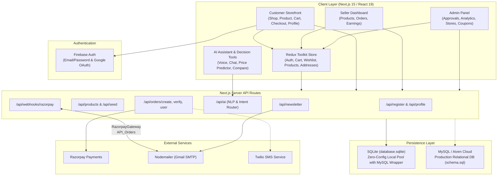
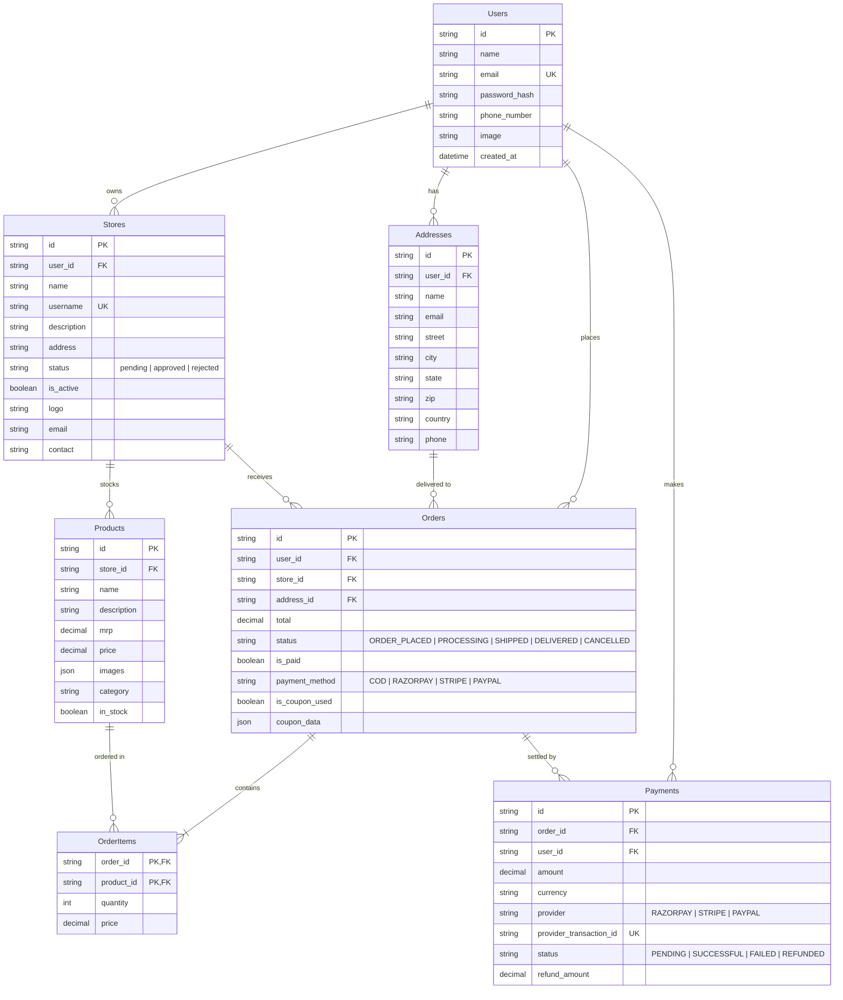
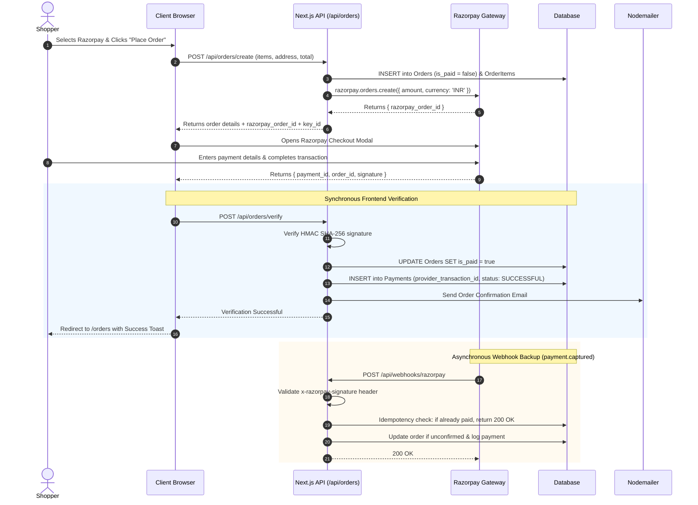

# 🛒 PaySphere — Modern Multi-Vendor E-Commerce Platform with AI Assistant

[-black?style=for-the-badge&logo=next.js)](https://nextjs.org/)
[](https://react.dev/)
[](https://tailwindcss.com/)
[](https://redux-toolkit.js.org/)
[](https://firebase.google.com/)
[](https://razorpay.com/)
[](https://www.mysql.com/)

**PaySphere** is a comprehensive, production-ready, full-stack multi-vendor e-commerce platform and marketplace web application. Built with **Next.js 15 (App Router & Turbopack)**, **React 19**, **Firebase Authentication**, **Redux Toolkit**, **Razorpay**, and an adaptable **SQLite / MySQL** dual-database architecture, PaySphere delivers a seamless experience across three dedicated portals: a **Customer Storefront**, a **Seller Dashboard**, and an **Admin Management Panel** — bolstered by interactive **AI Shopping Assistants and Decision Tools**.

---

## 📑 Table of Contents

- [Overview](#-overview)
- [Key Features](#-key-features)
  - [🛍️ Customer Storefront](#-customer-storefront)
  - [🤖 AI Shopping Assistant & Tools](#-ai-shopping-assistant--tools)
  - [🏪 Seller (Store) Portal](#-seller-store-portal)
  - [🔐 Admin Management Panel](#-admin-management-panel)
  - [💳 Payment Processing](#-payment-processing)
  - [📧 Automated Notifications](#-automated-notifications)
- [Platform Architecture](#-platform-architecture)
- [Tech Stack](#-tech-stack)
- [Project Directory Structure](#-project-directory-structure)
- [Database Architecture & Schema](#-database-architecture--schema)
  - [SQLite (Local / Development)](#sqlite-local--development)
  - [MySQL (Production / Cloud)](#mysql-production--cloud)
- [State Management (Redux Toolkit)](#-state-management-redux-toolkit)
- [API Reference](#-api-reference)
- [Getting Started](#-getting-started)
  - [Prerequisites](#prerequisites)
  - [1. Clone & Install Dependencies](#1-clone--install-dependencies)
  - [2. Environment Variables Configuration](#2-environment-variables-configuration)
  - [3. Database Setup & Seeding](#3-database-setup--seeding)
  - [4. Start Development Server](#4-start-development-server)
- [Payment & Webhook Lifecycle](#-payment--webhook-lifecycle)
- [Authentication Workflow](#-authentication-workflow)
- [Available Scripts](#-available-scripts)
- [License](#-license)

---

## 🌟 Overview

PaySphere unifies modern retail mechanics into a single codebase:
- **For Shoppers:** Effortless product browsing, search with autocomplete and category filtering, instant cart management with local caching, one-click wishlist curation, customizable checkout with coupon codes, Razorpay or COD payment, order tracking, and an intelligent voice/text AI assistant that helps compare products and forecast pricing.
- **For Sellers:** Streamlined store registration, self-serve inventory management with image uploads, real-time sales overview, order fulfillment tracking, and customer review monitoring.
- **For Administrators:** Centralized operational oversight, store review and approval pipeline, live seller activation controls, promotional discount coupon management, and dynamic revenue/sales analytics.

---

## ✨ Key Features

### 🛍️ Customer Storefront
- **Dynamic Catalog & Search** — Explore products with real-time text query filtering, category tags, and instant search results (`/shop`).
- **Dedicated Seller Stores** — Browse unique vendor pages (`/shop/[username]`) displaying customized vendor banners, descriptions, contact information, and store-specific inventory.
- **Interactive Product Details** — High-resolution image galleries with thumbnail switching, MRP discounts, real-time stock indicators, average star ratings, customer feedback reviews, and seller profiles (`/product/[productId]`).
- **Persistent Shopping Cart** — Add, remove, and update quantities with real-time subtotal calculation, synchronized via Redux and persisted in browser `localStorage` (`/cart`).
- **One-Click Wishlist** — Save desired products directly from product cards or detail pages, saved across sessions in `localStorage` (`/profile/wishlist`).
- **Flexible Checkout** — Seamless address selection, on-the-fly address addition/editing modal, discount coupon verification, and multiple payment methods (`/checkout`).
- **Customer Profile Hub** — A comprehensive self-service account center (`/profile`) with dedicated tabs:
  - **Dashboard:** Order counters, wishlist summaries, cart items count, and quick links.
  - **Personal Info:** Name, email, and phone management (`/profile/personal-info`).
  - **Order History:** Real-time order tracker with status stages (`Placed` → `Processing` → `Shipped` → `Delivered`) and itemized breakdown (`/orders`).
  - **Saved Addresses:** Multi-address management with add/edit capabilities (`/profile/addresses`).
  - **Payment Methods:** Saved cards and billing configurations (`/profile/payment`).
  - **Notification & Security Preferences:** Email alerts, order notifications, and password settings (`/profile/notifications`, `/settings`).
- **Plus Membership Plan** — A premium tier showcase (`/pricing`) offering free express shipping, extended returns, and exclusive member discounts.
- **Static & Legal Pages** — Integrated About (`/about`), Contact (`/contact`), and Privacy Policy (`/privacy-policy`) pages.

---

### 🤖 AI Shopping Assistant & Tools
- **Conversational AI Shopping Assistant (`AIAssistant`)**:
  - **Voice Recognition (Speech-to-Text)** via Web Speech API for hands-free queries.
  - **Voice Feedback (Text-to-Speech)** via Speech Synthesis with toggleable audio.
  - **Visual Search / Image Recognition** simulation for uploaded tech accessory photos.
  - **Natural Language Intent Navigation:** Direct routing on commands like *"Go to Cart"*, *"Show my orders"*, *"Take me home"*, or *"Go to checkout"*.
  - **Smart Filtering:** Intelligent parsing of natural queries such as *"Show me headphones under 3000"* or *"Compare speakers"*.
  - **Direct Actions:** Automated cart dispatching from conversation.
- **AI Price Prediction (`/ai/price-prediction`)** — Analyzes pricing patterns and sales history to forecast price drops so buyers purchase at optimal times.
- **AI Product Comparison (`/ai/product-comparison`)** — Side-by-side spec, pricing, and review comparison tool for up to 3 products.
- **AI Budget Planner (`/ai/budget-planner`)** — Input a target budget and required device types; the AI formulates a balanced device ecosystem within budget.
- **AI Recommendations (`/ai/recommendations`)** — Personalized recommendations generated from viewing trends and buying patterns.

---

### 🏪 Seller (Store) Portal
- **Seller Application & Onboarding** — Simple store registration (`/create-store`) capturing store name, handle, description, logo, email, address, and contact number.
- **Seller Dashboard (`/store`)** — Performance metrics displaying Total Products, Total Earnings, Total Orders, and Customer Ratings, plus a live customer review feed with star ratings and product links.
- **Product Management (`/store/add-product` & `/store/manage-product`)**:
  - Multi-image upload preview (up to 4 images).
  - Configurable pricing (MRP and selling price), category assignment, and markdown descriptions.
  - Live inventory table with instant in-stock/out-of-stock toggling.
- **Store Orders Fulfillment (`/store/orders`)** — Complete visibility of customer orders, delivery addresses, coupon codes used, payment methods, and status update dialogs.

---

### 🔐 Admin Management Panel
- **Executive Analytics Dashboard (`/admin`)** — Key metrics across the ecosystem: Total Products, Gross Revenue, Orders Count, and Registered Stores, complemented by an interactive visual area chart (`OrdersAreaChart`) powered by Recharts.
- **Store Approval Workflow (`/admin/approve`)** — Review pending merchant applications and approve or reject prospective stores with immediate feedback.
- **Live Stores Directory (`/admin/stores`)** — Manage registered stores with active/inactive status toggles.
- **Coupon Promotion Engine (`/admin/coupons`)** — Create promotional coupon codes with percentage discounts, custom expiry dates, and targeting rules (new user only, member only, or public).

---

### 💳 Payment Processing
- **Cash on Delivery (COD)** — Instant order creation with pending payment status and immediate email confirmation.
- **Razorpay Online Payments** — Dynamic server-side order generation (`/api/orders/create`), client-side Razorpay modal checkout, and secure HMAC-SHA256 signature verification (`/api/orders/verify`).
- **Webhook Integration (`/api/webhooks/razorpay`)** — Server-side webhook listener for `payment.captured` and `order.paid` events with built-in idempotency checks.
- **Payments Ledger** — Dedicated `Payments` table recording transaction reference IDs, amounts, currencies, provider names, and verification statuses.

---

### 📧 Automated Notifications
- **Order Confirmation Emails** — Clean HTML transactional emails sent upon successful checkout via Nodemailer (Gmail SMTP).
- **Newsletter Subscription Emails** — Automatic welcome emails sent when visitors subscribe through the footer or home newsletter forms (`/api/newsletter`).
- **Twilio SMS Ready** — Integrated Twilio dependencies and configuration variables ready for SMS order updates.

---

## 🏗️ Platform Architecture



---

## 🛠️ Tech Stack

| Layer | Technology | Purpose |
|---|---|---|
| **Framework** | [Next.js 15.3](https://nextjs.org/) | React framework with App Router, Turbopack, and hybrid SSR/CSR |
| **Frontend Library** | [React 19](https://react.dev/) | Core UI rendering engine |
| **Styling** | [Tailwind CSS 4](https://tailwindcss.com/) & PostCSS | Utility-first CSS styling |
| **State Management** | [Redux Toolkit](https://redux-toolkit.js.org/) & React-Redux | Global predictable state with `localStorage` sync |
| **Authentication** | [Firebase Auth 12](https://firebase.google.com/) | Email/password sign-up, Google OAuth popup, email verification |
| **Local Database** | [SQLite3](https://www.sqlite.org/) & `sqlite` | Default zero-configuration local database (`database.sqlite`) |
| **Cloud Database** | [MySQL2](https://github.com/sidorares/node-mysql2) | Scalable production database connector (e.g. Aiven Cloud) |
| **Payment Gateway** | [Razorpay](https://razorpay.com/) | Indian & global payments, checkout modal, HMAC signatures, webhooks |
| **Email Service** | [Nodemailer](https://nodemailer.com/) & [React Email](https://react.email/) | Transactional HTML order confirmations and newsletter receipts |
| **SMS Notifications** | [Twilio](https://www.twilio.com/) | SMS messaging support |
| **Data Visualization** | [Recharts 3](https://recharts.org/) | Responsive SVG charts for revenue and sales metrics |
| **Security & Hashing**| [bcryptjs](https://github.com/dcodeIO/bcrypt.js) | Password hashing for database user synchronizations |
| **Date Manipulation** | [date-fns 4](https://date-fns.org/) | Date parsing, arithmetic, and display formatting |
| **Icons & UI** | [Lucide React](https://lucide.dev/) & [React Hot Toast](https://react-hot-toast.com/) | Modern icon set and non-blocking toast notifications |

---

## 📁 Project Directory Structure

```
PaySphere/
├── app/
│   ├── (public)/                      # Customer-facing public route group
│   │   ├── layout.jsx                 # Public layout (Promotional Banner, Navbar, Footer)
│   │   ├── page.jsx                   # Homepage (Hero, Latest, Best Selling, Specs, Newsletter)
│   │   ├── about/page.jsx             # About PaySphere page
│   │   ├── contact/page.jsx           # Customer contact page
│   │   ├── privacy-policy/page.jsx    # Privacy policy & terms
│   │   ├── pricing/page.jsx           # PaySphere Plus membership pricing
│   │   ├── shop/                      # Product catalog browsing & search
│   │   │   ├── page.jsx               # Filterable product grid
│   │   │   └── [username]/page.jsx    # Individual seller storefront page
│   │   ├── product/[productId]/       # Product detail page with reviews & store link
│   │   ├── cart/page.jsx              # Shopping cart with item quantity controls
│   │   ├── checkout/page.jsx          # Checkout flow with address & coupon selection
│   │   ├── orders/page.jsx            # User order history with tracking statuses
│   │   ├── create-store/page.jsx      # Seller application registration form
│   │   ├── loading/page.jsx           # Public loading fallback
│   │   └── ai/                        # AI-assisted shopping tools
│   │       ├── price-prediction/      # Price drop tracker & forecast page
│   │       ├── product-comparison/    # Side-by-side product comparator
│   │       ├── budget-planner/        # Intelligent device budget distributor
│   │       └── recommendations/       # Personalized product curator
│   ├── admin/                         # Admin portal routes
│   │   ├── layout.jsx                 # Admin wrapper with auth guard
│   │   ├── page.jsx                   # Admin overview dashboard (Cards + Recharts area graph)
│   │   ├── approve/page.jsx           # Seller application approval / rejection
│   │   ├── stores/page.jsx            # Live store directory with activation toggles
│   │   └── coupons/page.jsx           # Promotional discount coupon manager
│   ├── store/                         # Seller (merchant) portal routes
│   │   ├── layout.jsx                 # Seller layout with store navigation
│   │   ├── page.jsx                   # Seller dashboard (sales, products, orders, review feed)
│   │   ├── add-product/page.jsx       # Multi-image product creation form
│   │   ├── manage-product/page.jsx    # Inventory table with in-stock toggle
│   │   └── orders/page.jsx            # Store customer orders fulfillment table
│   ├── profile/                       # User profile management hub
│   │   ├── layout.jsx                 # Profile sidebar layout with auth protection
│   │   ├── page.jsx                   # Profile dashboard (stats, recent orders, viewed items)
│   │   ├── personal-info/page.jsx     # Personal info editor (name, email, phone)
│   │   ├── addresses/page.jsx         # Shipping addresses manager
│   │   ├── wishlist/page.jsx          # Saved wishlist with move-to-cart actions
│   │   ├── payment/page.jsx           # Saved payment methods
│   │   ├── notifications/page.jsx     # Email & order alert preferences
│   │   └── settings/page.jsx          # Profile credentials & account settings
│   ├── login/page.jsx                 # Authentication (Email/Password & Google OAuth)
│   ├── settings/page.jsx              # Global user preferences & security page
│   ├── api/                           # Backend Next.js API route handlers
│   │   ├── register/route.js          # POST — Sync user to database with bcrypt
│   │   ├── profile/                   # GET/PUT — Retrieve and edit user profile
│   │   │   ├── route.js               # GET — Fetch user data and addresses
│   │   │   └── edit/route.js          # PUT — Update user phone/details
│   │   ├── addresses/route.js         # POST/PUT — Add or update shipping addresses
│   │   ├── products/route.js          # GET — Fetch product catalog
│   │   ├── seed/route.js              # GET — Populate database with sample catalog
│   │   ├── ai/route.js                # POST — NLP assistant & intent router
│   │   ├── orders/                    # Order processing endpoints
│   │   │   ├── create/route.js        # POST — Initialize COD or Razorpay order
│   │   │   ├── verify/route.js        # POST — Verify Razorpay HMAC signature
│   │   │   └── user/route.js          # GET — Retrieve order history for user
│   │   ├── newsletter/route.js        # POST — Subscribe email & dispatch confirmation
│   │   └── webhooks/                  # External gateway webhook listeners
│   │       └── razorpay/route.js      # POST — Razorpay event verification & fulfillment
│   ├── layout.jsx                     # Root Next.js layout (Outfit font, Toaster, StoreProvider)
│   ├── StoreProvider.js               # Redux Provider with localStorage sync
│   └── globals.css                    # Tailwind CSS imports & global styles
├── components/                        # Modular React UI components
│   ├── Navbar.jsx                     # Top navigation with live search, cart counter, auth menu
│   ├── Hero.jsx                       # Homepage promotional hero banner
│   ├── Banner.jsx                     # Top announcement marquee banner
│   ├── Footer.jsx                     # Global footer with link columns and newsletter form
│   ├── ProductCard.jsx                # Product card with wishlist toggle & ratings
│   ├── ProductDetails.jsx             # Product image gallery & quantity selector
│   ├── ProductDescription.jsx         # Description & review tabs with store details
│   ├── OrderSummary.jsx               # Checkout subtotal, coupon input, & payment selector
│   ├── OrderItem.jsx                  # Order item row with status badge
│   ├── OrdersAreaChart.jsx            # Recharts analytics chart for admin dashboard
│   ├── AddressModal.jsx               # Dialog for adding or updating shipping address
│   ├── RatingModal.jsx                # Dialog for rating & reviewing purchased items
│   ├── Rating.jsx                     # Star rating visualization
│   ├── Counter.jsx                    # Incremental quantity counter
│   ├── AIAssistant.jsx                # Floating AI shopping companion with voice & speech
│   ├── Newsletter.jsx                 # Subscription banner
│   ├── LatestProducts.jsx             # New arrivals product shelf
│   ├── BestSelling.jsx                # Top seller showcase shelf
│   ├── OurSpec.jsx                    # Customer value proposition badges
│   ├── CategoriesMarquee.jsx          # Animated category pills
│   ├── AuthProvider.jsx               # Firebase auth listener syncing to Redux
│   ├── Loading.jsx                    # Reusable spinner loader
│   ├── PageTitle.jsx                  # Standard page header component
│   ├── Title.jsx                      # Section title component
│   ├── admin/                         # Admin portal components
│   │   ├── AdminLayout.jsx            # Admin authorization wrapper
│   │   ├── AdminNavbar.jsx            # Admin top bar
│   │   ├── AdminSidebar.jsx           # Admin navigation links
│   │   └── StoreInfo.jsx              # Store application detail viewer
│   └── store/                         # Seller portal components
│       ├── StoreLayout.jsx            # Seller authorization wrapper
│       ├── StoreNavbar.jsx            # Seller top bar
│       └── StoreSidebar.jsx           # Seller navigation links
├── lib/                               # Core libraries & utilities
│   ├── db.js                          # SQLite database pool with MySQL compatibility wrapper
│   ├── firebase.js                    # Firebase Client App & Auth initialization
│   ├── email.js                       # Nodemailer transporter & email templates
│   ├── store.js                       # Redux store configuration
│   └── features/                      # Redux Toolkit state slices
│       ├── auth/authSlice.js          # Authentication state & user object
│       ├── cart/cartSlice.js          # Cart items map with quantity controls
│       ├── wishlist/wishlistSlice.js  # Saved wishlist items array
│       ├── product/productSlice.js    # Catalog products list
│       ├── address/addressSlice.js    # User addresses list
│       └── rating/ratingSlice.js      # Product ratings state
├── assets/                            # Static media and mock assets
│   ├── assets.js                      # Dummy data (products, stores, ratings, coupons)
│   ├── upload_area.svg                # Upload icon placeholder
│   └── *.png / *.jpg / *.webp         # Curated product images and brand logos
├── database.sqlite                    # Local SQLite database file (created automatically)
├── schema.sql                         # MySQL database schema (7 relational tables)
├── run_schema.mjs                     # MySQL migration script for Aiven Cloud or standard MySQL
├── run_seed.js                        # Node runner to trigger catalog seeding via /api/seed
├── next.config.mjs                    # Next.js configurations (unoptimized images enabled)
├── postcss.config.mjs                 # PostCSS configuration for Tailwind CSS 4
├── jsconfig.json                      # Path aliases configuration (@/*)
└── package.json                       # Project metadata, dependencies, and npm scripts
```

---

## 🗄️ Database Architecture & Schema

PaySphere supports **two database modes**:

### SQLite (Local / Development)
By default, the application runs off an embedded SQLite database (`database.sqlite`) via `lib/db.js`. It requires **zero external database setup**:
- Tables (`Users`, `Addresses`, `Orders`, `OrderItems`, `Products`) are automatically initialized on startup with `CREATE TABLE IF NOT EXISTS`.
- A MySQL-compatibility wrapper simulates `db.execute()`, `db.query()`, and MySQL `[rows]` destructuring so that both engines use identical API route code.

### MySQL (Production / Cloud)
For production deployments (such as **Aiven Cloud MySQL**, AWS RDS, or local MySQL 8), the complete relational schema is provided in `schema.sql`:



---

## 🧩 State Management (Redux Toolkit)

The frontend manages application state through Redux Toolkit with per-request store creation (`lib/store.js`) and a client wrapper (`StoreProvider.js`):

| Slice | File Path | Responsibilities & Reducers |
|---|---|---|
| **`auth`** | `lib/features/auth/authSlice.js` | Manages `isLoggedIn`, `user` profile data, and `authLoading` status. Synchronized with Firebase via `AuthProvider`. |
| **`cart`** | `lib/features/cart/cartSlice.js` | Manages `cartItems` (`{ [productId]: quantity }`). Provides `addToCart`, `removeFromCart`, `deleteItemFromCart`, `clearCart`, and `setCart`. Automatically synchronized with `localStorage`. |
| **`wishlist`** | `lib/features/wishlist/wishlistSlice.js` | Manages an array of favorited items (`items: []`). Provides `addToWishlist`, `removeFromWishlist`, `clearWishlist`, and `setWishlist`. Automatically synchronized with `localStorage`. |
| **`product`** | `lib/features/product/productSlice.js` | Stores the active product catalog loaded on mount from `/api/products`. |
| **`address`** | `lib/features/address/addressSlice.js` | Manages user shipping addresses list with `setAddresses` and `addAddress`. |
| **`rating`** | `lib/features/rating/ratingSlice.js` | Stores and manages product ratings and review lists. |

---

## 📡 API Reference

All backend functionality is implemented via Next.js App Router API Route Handlers:

| Method | Route | Description | Request Body / Params |
|---|---|---|---|
| `POST` | `/api/register` | Stores a registered user in the database with bcrypt hashed password. | `{ uid, name, email, phone, password }` |
| `GET` | `/api/profile` | Fetches user profile information and all saved addresses. | Query: `?uid=<user_id>` |
| `PUT` | `/api/profile/edit` | Updates user details (such as phone number). | `{ uid, phone_number }` |
| `POST` | `/api/addresses` | Adds a new shipping address for a user. | `{ id, user_id, name, street, city, state, zip, country, phone, email }` |
| `PUT` | `/api/addresses` | Updates an existing shipping address. | `{ id, user_id, name, street, city, state, zip, country, phone, email }` |
| `GET` | `/api/products` | Retrieves the list of all products from the database. | None |
| `GET` | `/api/seed` | Seeds database with products from `assets.js` (clears existing). | None |
| `POST` | `/api/ai` | Processes natural language shopping queries, commands, and image search. | `{ type: "text"\|"voice"\|"image", payload: string, context: object }` |
| `POST` | `/api/orders/create` | Creates an order in database; initiates Razorpay order if method is online. | `{ user_id, user_email, user_name, address_id, items, total, payment_method, coupon_data }` |
| `POST` | `/api/orders/verify` | Validates Razorpay HMAC signature, updates order to paid, and logs transaction. | `{ razorpay_payment_id, razorpay_order_id, razorpay_signature, order_id, user_id, amount }` |
| `GET` | `/api/orders/user` | Fetches all orders, line items, and delivery details for a user. | Query: `?uid=<user_id>` |
| `POST` | `/api/newsletter` | Subscribes an email to the newsletter and sends a confirmation email. | `{ email }` |
| `POST` | `/api/webhooks/razorpay` | Asynchronous Razorpay webhook handler for `payment.captured` & `order.paid`. | Raw Razorpay Webhook Payload + `x-razorpay-signature` header |

---

## 🚀 Getting Started

### Prerequisites

- **Node.js**: v18.x or higher (v20+ recommended)
- **npm** or **yarn** or **pnpm**
- **Firebase Account**: A Firebase project with Email/Password & Google Sign-In enabled
- **Razorpay Account**: Razorpay Test or Live key pair
- **Gmail Account**: With an [App Password](https://myaccount.google.com/apppasswords) configured for Nodemailer
- *(Optional)* **MySQL Database**: Required only if switching away from the default SQLite database to Aiven Cloud or standard MySQL

---

### 1. Clone & Install Dependencies

```bash
git clone https://github.com/your-username/PaySphere.git
cd PaySphere
npm install
```

---

### 2. Environment Variables Configuration

Create a `.env` (or `.env.local`) file in the root directory:

```env
# Currency symbol used across storefront ($ or ₹ or € or £)
NEXT_PUBLIC_CURRENCY_SYMBOL=$

# Razorpay Payment Gateway Credentials
RAZORPAY_KEY_ID=rzp_test_your_key_id
RAZORPAY_KEY_SECRET=your_razorpay_key_secret
RAZORPAY_WEBHOOK_SECRET=your_razorpay_webhook_secret

# Email Service (Nodemailer with Gmail)
EMAIL_USER=your_email@gmail.com
EMAIL_PASS=your_gmail_16_char_app_password

# Twilio SMS Notifications (Optional)
TWILIO_ACCOUNT_SID=your_twilio_account_sid
TWILIO_AUTH_TOKEN=your_twilio_auth_token
TWILIO_PHONE_NUMBER=your_twilio_phone_number

# MySQL Configuration (Optional: only needed if using MySQL instead of default SQLite)
DB_HOST=your-mysql-host.aivencloud.com
DB_USER=avnadmin
DB_PASSWORD=your_db_password
DB_PORT=3306
DB_NAME=paysphere
```

> [!NOTE]
> Firebase credentials are pre-configured in `lib/firebase.js`. To connect your own project, update the `firebaseConfig` object in `lib/firebase.js`.

---

### 3. Database Setup & Seeding

#### Option A: Default SQLite (Fastest, zero configuration)
Start the application and populate initial catalog products:

```bash
# In one terminal, start the app:
npm run dev

# In another terminal, run the seed script:
node run_seed.js
```
The seed endpoint (`/api/seed`) will populate `database.sqlite` with sample products, categories, descriptions, and mock ratings.

#### Option B: MySQL / Aiven Cloud Database
If using MySQL, execute the schema migration script:

```bash
node run_schema.mjs
```

---

### 4. Start Development Server

```bash
npm run dev
```

Open [http://localhost:3000](http://localhost:3000) in your browser.

---

## 💳 Payment & Webhook Lifecycle



---

## 🔐 Authentication Workflow

1. **Sign Up (`/login`)**:
   - User provides Name, Email, Phone, and Password.
   - Account is created via Firebase Auth `createUserWithEmailAndPassword`.
   - User profile is immediately synchronized to the backend via `/api/register` with `bcrypt` password hashing.
   - An email verification link is dispatched via Firebase, and the user is logged out until their email is verified.
2. **Sign In (`/login`)**:
   - Supports Email/Password authentication and one-click Google OAuth via `signInWithPopup`.
   - The user's `emailVerified` flag is validated; unverified users are directed to check their inbox.
3. **Global Session Sync (`AuthProvider.jsx`)**:
   - Firebase's `onAuthStateChanged` observer detects sign-in/sign-out actions.
   - Dispatches `login` or `logout` actions to the Redux `auth` slice.
   - User avatar initial, dropdown navigation, and protected routes dynamically adjust.

---

## 📜 Available Scripts

| Command | Description |
|---|---|
| `npm run dev` | Runs the development server with **Turbopack** at `http://localhost:3000` |
| `npm run build` | Compiles the production application build |
| `npm run start` | Runs the compiled production build |
| `npm run lint` | Runs Next.js ESLint checks |
| `node run_seed.js` | Executes the product catalog seeding against the running server (`/api/seed`) |
| `node run_schema.mjs` | Executes `schema.sql` against the configured MySQL database |

---

## 🤝 Contributing & Customization

1. **Portals Routing:**
   - Public pages: `app/(public)/`
   - Store / Seller pages: `app/store/`
   - Admin pages: `app/admin/`
   - Profile pages: `app/profile/`
2. **Components & Layouts:**
   - Header, Footer, Hero, and Catalog widgets live in `components/`
   - Portal-specific sidebars and headers are organized in `components/admin/` and `components/store/`
3. **Database Configuration:**
   - To toggle or modify database operations, refer to `lib/db.js` for SQLite and `schema.sql` for MySQL.

---

## 📄 License

This project is private and maintained for educational, commercial, and demonstration purposes. All rights reserved.

---

<p align="center">
  <b>Built with ❤️ using Next.js 15, React 19, Firebase, SQLite / MySQL & Razorpay</b>
</p>
